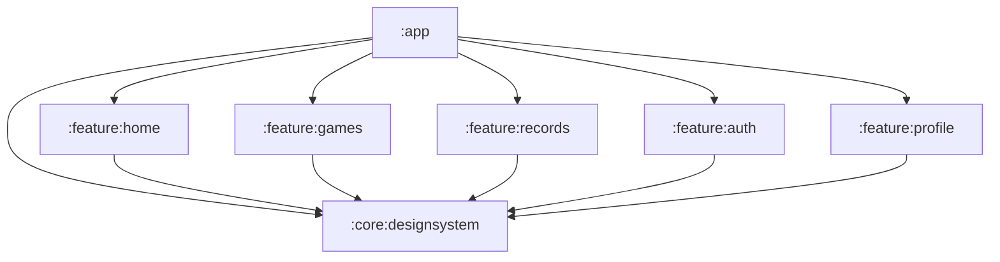
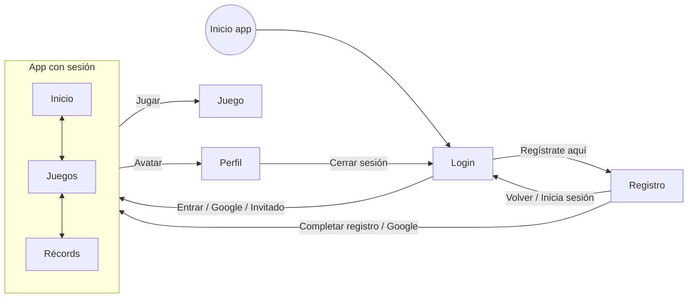

# MiniJuegos Hub

App Android de minijuegos construida con **Jetpack Compose** a partir del prototipo de Figma
[Prototipo-Demo-UiKit](https://www.figma.com/design/KqTFktvrRvCzO2idPga5xf/Prototipo-Demo-UiKit).
El proyecto sigue **Atomic Design** (tokens → átomos → moléculas → organismos → pantallas) con un
design system propio en un módulo independiente y un módulo por feature.

> Rama de trabajo: `multi_game_compose`. Paquete: `com.invex.one.template` (nombre de app: *Template*).

---

## Índice

- [Estado actual](#estado-actual)
- [Stack](#stack)
- [Cómo ejecutar](#cómo-ejecutar)
- [Arquitectura](#arquitectura)
- [Navegación](#navegación)
- [Design system](#design-system)
- [Pantallas implementadas](#pantallas-implementadas)
- [Minijuegos](#minijuegos)
- [Convenciones](#convenciones)
- [Cómo implementar una nueva pantalla de Figma](#cómo-implementar-una-nueva-pantalla-de-figma)
- [Pendientes conocidos](#pendientes-conocidos)

---

## Estado actual

| Área | Estado |
|---|---|
| Design system (`:core:designsystem`) | ✅ Tokens, 16 átomos, 12 moléculas, 3 organismos, 92 iconos, 3 familias tipográficas |
| Login (pantalla de inicio) | ✅ |
| Registro | ✅ |
| Inicio, Juegos, Récords (pestañas) | ✅ |
| Perfil | ✅ |
| Contenedor de juegos + registro de 17 juegos | ✅ (los juegos aún son composables vacíos) |
| Backend / autenticación real | ⛔ No existe: los datos son de muestra y las acciones de cuenta son locales |
| Persistencia de sesión | ⛔ La sesión vive en *saved state* (se pierde al cerrar la app) |
| Tema oscuro | ⛔ Figma solo define tema claro |

Historial relevante:

```
17aa5f4 Make Login the start screen
95c109f Add Profile screen from Figma
dac9491 Add Register screen from Figma and Login ⇄ Register flow
3074ee7 Add Login screen from Figma
d2fe9dd Add Games catalog screen from Figma and launch mini games
719374a Add Records screen from Figma and share app chrome across tabs
9202f60 Add design system module and MiniJuegos Hub home screen from Figma
```

## Stack

| | Versión |
|---|---|
| Android Gradle Plugin | 8.13.2 |
| Kotlin | 2.0.21 (plugin Compose) |
| Compose BOM | 2024.09.00 (Material 3) |
| Lifecycle (ViewModel / `collectAsStateWithLifecycle`) | 2.9.4 |
| `compileSdk` / `targetSdk` | 36 |
| `minSdk` | 24 |
| JVM target | 11 |

Sin dependencias de terceros más allá de AndroidX. Las fuentes (Outfit, Plus Jakarta Sans, Space
Grotesk) van empaquetadas como TTF estáticos en `core/designsystem/src/main/res/font` para que
funcionen desde API 24.

## Cómo ejecutar

```bash
# Compilar
./gradlew :app:assembleDebug

# Instalar en un emulador/dispositivo conectado
./gradlew :app:installDebug
adb shell am start -n com.invex.one.template/.MainActivity
```

Cada pantalla y la mayoría de los componentes tienen `@Preview` para revisarlos en Android Studio
sin ejecutar la app.

## Arquitectura

### Módulos



| Módulo | Responsabilidad |
|---|---|
| `:app` | `MainActivity`, flujo de navegación (`TemplateApp`), barra superior compartida, registro y contenedor de juegos, `Screen.kt` con los composables de los juegos |
| `:core:designsystem` | Tokens, tema, átomos, moléculas, organismos, iconos, fuentes y utilidades de formato. **No conoce ningún feature** |
| `:feature:home` | Pestaña *Inicio* |
| `:feature:games` | Pestaña *Juegos* y `GameCatalog` (fuente única de los juegos) |
| `:feature:records` | Pestaña *Récords* |
| `:feature:auth` | *Login* y *Registro* |
| `:feature:profile` | *Perfil* |

Los features no dependen entre sí; se comunican a través de `:app` mediante callbacks e ids de
juego compartidos (`"2048"`, `"whack"`, `"snake"`…).

> Las carpetas `core/model`, `core/ui` y `feature/{agenda,athlete,…}` que aparecen sin seguimiento
> en el árbol son restos de compilación de la rama `sport_kids`; no forman parte del proyecto.

### Estructura de un feature

```
feature/<nombre>/src/main/
├── java/.../feature/<nombre>/
│   ├── <Nombre>Screen.kt        # <Nombre>Route (stateful) + <Nombre>Screen (stateless, @Preview)
│   ├── <Nombre>ViewModel.kt     # StateFlow<UiState>, eventos como funciones
│   ├── model/                   # UiState y modelos (@Immutable)
│   ├── data/                    # Datos de muestra hasta tener repositorio
│   └── component/               # Organismos propios de la pantalla (internal)
└── res/values/strings.xml       # Textos es-MX, con plurals
```

Patrón de cada pantalla:

- **`XRoute`**: obtiene el `ViewModel` (`viewModel()`), recoge el estado con
  `collectAsStateWithLifecycle()` y registra el `BackHandler` si aplica.
- **`XScreen`**: recibe `state` + callbacks; no conoce el ViewModel. Es la que se previsualiza.
- Cuando hay muchos eventos se agrupan en data classes (`LoginActions`, `RegisterCallbacks`,
  `ProfileActions`…).
- Las pestañas reciben `contentPadding` desde la app para dibujar debajo de las barras translúcidas.

## Navegación



- `TemplateApp` (en `MainActivity.kt`) muestra `AuthFlow` mientras no hay sesión y `SignedInApp`
  después.
- **Login es la pantalla raíz**: no tiene botón *Volver* y el *back* del sistema sale de la app.
- El estado de navegación usa `rememberSaveable` (sobrevive a rotaciones). No se usa
  Navigation Compose todavía.
- Al cerrar sesión, el estado de `SignedInApp` se descarta y la siguiente entrada empieza en *Inicio*.

## Design system

Módulo `:core:designsystem`, paquete `com.invex.one.template.core.designsystem`.

### Uso

```kotlin
AppTheme {                                  // provee tokens + MaterialTheme equivalente
    Text("Hola", style = AppTheme.typography.title, color = AppTheme.colors.onSurface)
    Spacer(Modifier.height(AppTheme.spacing.lg))
    PrimaryButton(text = "Jugar", onClick = {}, trailingIcon = AppIcons.Play)
}
```

**Regla:** los componentes y pantallas no usan colores, `dp` ni `sp` literales; todo sale de
`AppTheme.*`, `AppSize`, `AppAlpha` o `AppIcons`.

### Tokens (`token/`)

| Token | Archivo | Contenido |
|---|---|---|
| Colores primitivos | `ColorPalette.kt` | Paleta cruda (`Green40`, `Indigo98`…). `internal`: no se usa fuera del módulo |
| Colores semánticos | `AppColors.kt` | Roles M3: `primary`, `primaryContainer`, `primaryFixed(Dim)`, `secondary…`, `tertiary…`, `error(Container)`, `surface`, `surfaceContainer{Lowest…Highest}`, `onSurface(Variant)`, `outline(Variant)`, `inverseSurface`… Solo existe `LightAppColors` |
| Transparencias | `AppColors.kt` → `AppAlpha` | `Tint`, `TintSubtle`, `TintMedium`, `TintStrong`, `Ambient`, `Half`, `Overlay`, `Ring`, `Glow`, `Depth`, `BarTop`, `BarBottom` |
| Tipografía | `AppTypography.kt` | `display`, `headline`, `titleLarge`, `title`, `subtitle`, `bodyLarge`, `body`, `bodySmall`, `bodySmallStrong`, `micro`, `buttonLarge`, `button`, `label`, `overline`, `numeric`, `numericSmall`, `secret` |
| Espaciado | `AppSpacing.kt` | `xxxs 2` · `xxs 4` · `xs 6` · `sm 8` · `smd 10` · `md 12` · `mdLg 14` · `lg 16` · `xl 24` · `xxl 32` |
| Tamaños fijos | `AppSpacing.kt` → `AppSize` | Alturas de barras, botones y campos, avatares, tiles, switch, área táctil mínima (44dp)… |
| Formas | `AppShapes.kt` | `tiny 3` · `extraSmall 8` · `small 12` · `medium 16` · `mediumLarge 18` · `large 20` · `pill` |
| Elevación | `AppElevation.kt` | `none` · `xs` · `bar` · `md` · `lg` |

Tipografías de Figma:

| Familia | Uso |
|---|---|
| **Outfit** (SemiBold, Bold, ExtraBold) | Títulos, saludos, CTAs grandes |
| **Plus Jakarta Sans** (Medium, Bold) | Texto de cuerpo, campos, subtítulos |
| **Space Grotesk** (Bold) | Etiquetas, chips, botones, números |

### Tema (`theme/`)

- `AppTheme { }`: provee los tokens por `CompositionLocal` y un `MaterialTheme` equivalente, para
  que los componentes de Material (diálogos, menús, ripples) usen la misma paleta.
- `Modifier.appShadow(...)`: sombra suave con color del tema.
- `Modifier.depthShadow(...)`: sombra sólida desplazada (efecto "botón arcade").

### Átomos (`atom/`)

| Componente | Descripción |
|---|---|
| `AppIcon` | Icono del set a tamaño original de Figma; `tint` opcional |
| `PrimaryButton` | Variantes `Primary` / `Accent`, tamaños `Medium` / `Large`, iconos inicial/final |
| `SecondaryButton` | `Surface` / `Tonal`, icono opcional, forma y alto configurables |
| `TextLinkButton` | Enlace con chevron ("Ver historial ›") |
| `ChipButton` | Pastilla blanca con icono ("Ranking global") |
| `TonalIconButton` · `InlineIconButton` · `SmallTonalIconButton` · `IconCircle` | Botones de icono y círculo con icono |
| `StatChip` | Pastilla con icono + texto (`Regular` / `Compact`) |
| `StatusPill` | Pastilla con punto de estado ("● 17 disponibles") |
| `AppFilterChip` | Filtro seleccionable (seleccionado = relleno oscuro) |
| `CategoryTag` · `InlineBadge` | Etiquetas de categoría / insignias pequeñas |
| `RankBadge` | Posición con medalla (podio) o número |
| `IconTile` · `MonogramTile` | Cuadro con icono o iniciales |
| `AppAvatar` | Avatar circular con anillo |
| `AppProgressBar` · `StrengthMeter` | Barra de progreso / medidor segmentado |
| `AppCheckbox` | `Regular` (24dp) / `Small` (14dp) |
| `AppSwitch` | `Regular` (48×28) / `Small` (44×24), animado |

### Moléculas (`molecule/`)

| Componente | Descripción |
|---|---|
| `AppTextField` | Campo con etiqueta (`FieldLabel`), acción, icono inicial opcional, slot final, ayuda (`FieldSupport`), alto y estilo configurables |
| `AppPickerField` | Igual que un campo pero de solo lectura; abre un selector |
| `AppDatePickerDialog` · `formatUtcDate` | Selector de fecha tematizado (fechas en UTC) |
| `CheckboxRow` | Casilla + título + texto de apoyo; toda la fila alterna |
| `SettingsNavigationRow` · `SettingsSwitchRow` | Filas de ajustes con chevron o switch (`SettingsRowStyle`) |
| `StatTile` | KPI con icono, valor y etiqueta (`Default` / `Compact`) |
| `ValueRow` | Etiqueta + valor numérico ("Récord 4.096 pts") |
| `AvatarOptionCard` | Avatar seleccionable con anillo y check |
| `HeadingBlock` · `BarTitle` · `ScreenHeader` · `SectionHeader` | Encabezados |
| `LabeledDivider` | Divisor con texto centrado |
| `NavBarItem` | Destino de la barra inferior |

### Organismos (`organism/`)

| Componente | Descripción |
|---|---|
| `AppBarContainer` | Contenedor translúcido de 64dp que respeta la barra de estado |
| `AppTopBar` | Logo + título + sección + acciones (pestañas) |
| `BrandTopBar` | *Volver* (opcional) + marca + perfil (auth y perfil) |
| `AppBottomBar` | Barra inferior translúcida |

### Iconos e imágenes

- `AppIcons` registra los **92 VectorDrawables** exportados de Figma (`res/drawable/ic_*.xml`).
  Conservan el color de Figma; se tiñen con `tint` cuando depende del estado.
- Las imágenes de contenido (avatar de muestra, foto de perfil, avatares de registro) viven en el
  `res/drawable-nodpi` del módulo que las usa.

## Pantallas implementadas

| Pantalla | Nodo Figma | Módulo | Entrada |
|---|---|---|---|
| Inicio | [`186:405`](https://www.figma.com/design/KqTFktvrRvCzO2idPga5xf/Prototipo-Demo-UiKit?node-id=186-405) | `:feature:home` | `HomeRoute` |
| Récords | [`186:199`](https://www.figma.com/design/KqTFktvrRvCzO2idPga5xf/Prototipo-Demo-UiKit?node-id=186-199) | `:feature:records` | `RecordsRoute` |
| Juegos | [`186:3`](https://www.figma.com/design/KqTFktvrRvCzO2idPga5xf/Prototipo-Demo-UiKit?node-id=186-3) | `:feature:games` | `GamesRoute` |
| Login | [`192:4`](https://www.figma.com/design/KqTFktvrRvCzO2idPga5xf/Prototipo-Demo-UiKit?node-id=192-4) | `:feature:auth` | `LoginRoute` |
| Registro | [`193:142`](https://www.figma.com/design/KqTFktvrRvCzO2idPga5xf/Prototipo-Demo-UiKit?node-id=193-142) | `:feature:auth` | `RegisterRoute` |
| Perfil | [`196:353`](https://www.figma.com/design/KqTFktvrRvCzO2idPga5xf/Prototipo-Demo-UiKit?node-id=196-353) | `:feature:profile` | `ProfileRoute` |

Comportamiento destacado:

- **Inicio**: reto del día con progreso, estadísticas rápidas desplazables y carrusel de juegos
  más usados; "Jugar" abre el juego.
- **Juegos**: grid de 2 columnas con filtro por categoría (`GamesViewModel`). Los juegos sin arte
  en Figma muestran iniciales.
- **Récords**: resumen de métricas y lista con podio (oro, plata, bronce).
- **Login**: es la pantalla de inicio de la app. Muestra/oculta contraseña, "Recordar en este
  equipo", y entra con correo, Google o como invitado.
- **Registro**: avatar, gamertag con disponibilidad, fecha de nacimiento con selector,
  medidor de fuerza de contraseña, confirmación y términos con enlaces.
- **Perfil**: modo edición (bloquea/habilita campos), personaje, edad y categoría calculadas,
  región con menú, ajustes de privacidad, guardar/descartar y cerrar sesión.

## Minijuegos

- `app/.../Screen.kt` declara los 17 composables de juego (`Numbers`, `WhackAmole`, `Snake`,
  `TetrisCompose`, …). **Hoy están vacíos.**
- `GameCatalog` (`:feature:games`) es la lista única de juegos: id, nombre, descripción y categoría.
- `GameRegistry` (`:app`) asocia cada id con su composable; `GameHostScreen` lo ejecuta a pantalla
  completa con barra de *Volver*.

Para agregar un juego:

1. Implementa su composable en `Screen.kt` (o en su propio archivo/módulo).
2. Agrega la entrada en `GameCatalog.games` con un id nuevo.
3. Registra `"id" to { MiJuego() }` en `GameRegistry`.
4. (Opcional) Agrega su arte en `AppIcons` y mapéalo en `Game.artwork()`.

## Convenciones

- **Idioma**: UI en español (es-MX); código, nombres y KDoc en inglés.
- **Textos** siempre en `strings.xml` del módulo, con `plurals` para cantidades. Los nombres
  propios de datos (juegos, avatares) viven en los modelos.
- **Números** con punto de miles como en Figma: `formatScore(4096) == "4.096"`.
- **Fechas** de los selectores en milisegundos UTC; se muestran con `formatUtcDate`.
- **Estado** inmutable (`@Immutable data class`) expuesto como `StateFlow`; la UI no muta estado.
- **Accesibilidad**: `contentDescription` en iconos interactivos, `Role` en elementos clicables,
  filas completas como objetivo táctil, encabezados con `semantics { heading() }`.
- **Edge-to-edge**: barras del sistema transparentes con iconos oscuros (el diseño es claro).
- **Commits**: uno por pantalla/cambio funcional; `.idea/` no se versiona en estos commits.

## Cómo implementar una nueva pantalla de Figma

1. Obtén el contexto y la captura del nodo (Figma MCP `get_design_context`).
2. Descarga los assets **inmediatamente** (las URLs temporales caducan). A las URLs del MCP hay
   que añadirles la extensión (`.svg` / `.png`) o devuelven 404.
3. Compara los SVG con los iconos existentes (por `pathData`) y **reutiliza** los idénticos; si
   solo cambia el color, usa `tint`.
4. Convierte los SVG nuevos a VectorDrawable conservando ancho, alto y color de Figma, y
   regístralos en `AppIcons`.
5. Revisa qué tokens y componentes ya existen. Agrega tokens o variantes al design system solo
   cuando el diseño no se pueda expresar con lo actual.
6. Crea el feature con `Route` + `Screen` + `ViewModel` + `strings.xml` y conéctalo en `:app`.
7. Verifica en el emulador contra la captura de Figma y documenta las desviaciones intencionales.

Particularidades del archivo de Figma:

- No tiene **variables**: los tokens se derivaron de los valores del diseño.
- Algunos exports vienen rotos (p. ej. el check del registro tiene `opacity 0` y raíz de 32×32);
  en esos casos se usa el tamaño del espacio del diseño.
- Los frames repiten la barra superior con el subtítulo "Inicio" y sin pestaña seleccionada; en
  código el subtítulo y la pestaña siguen la navegación real.

## Pendientes conocidos

- **Backend**: login, registro, Google, recuperación de contraseña, verificación de correo,
  cambio de contraseña/foto y guardado de perfil son locales o `TODO`.
- **Sesión persistente**: "Recordar en este equipo" aún no guarda nada (candidato: DataStore).
- **Juegos**: los 17 composables de `Screen.kt` están vacíos. 10 juegos no tienen arte ni textos
  definitivos en Figma (nombres y descripciones provisionales en `GameCatalog`).
- **Arte de avatares**: las imágenes de avatar del registro son capturas de relleno del prototipo.
- **Catálogo de personajes duplicado**: Astro, Valeria, CiberBot y Draco están definidos en
  `:feature:auth` (imágenes) y `:feature:profile` (iconos); conviene unificarlos en un módulo
  compartido.
- **Navegación**: migrar a Navigation Compose cuando crezca el número de pantallas.
- **Tema oscuro**: definir un `AppColors` oscuro cuando exista en Figma.
- **Pantallas sin diseño**: contenedor de juego y estados vacíos/error usan solo tokens.
