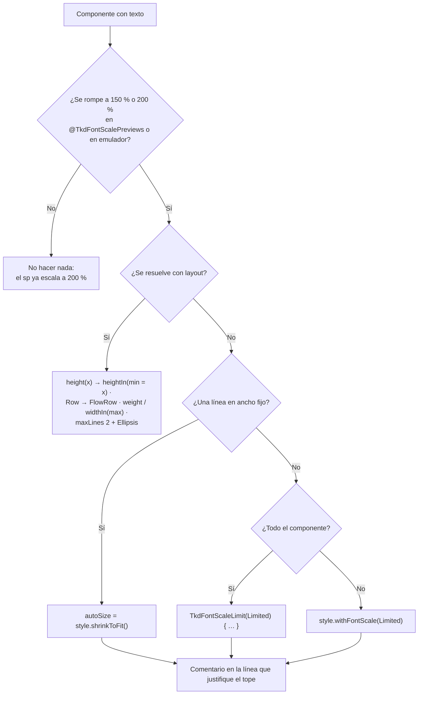

# 🔠 Escala de fuente (150 % / 200 %) en Kensho

> **Versión:** 1.0.0 · **Fecha:** 2026-10-28 · **Estado:** ✅ implementado (ADR-015)
> **Alcance:** `ui/theme/TkdFontScale.kt` y los componentes `Tkd*` y secciones de pantalla con texto en espacio fijo
> **Reglas:** `A11Y-06` (texto escalable) · `CMP-09` (previews) · `THM-02` (sin `sp` literales) · `FF-13` (sin multiplicar `fontScale`)

> **¿Por qué existe este documento?**
> Cuando el usuario sube el tamaño de fuente del sistema a 150 % o 200 %, Kensho debe seguir siendo legible y usable (WCAG 1.4.4). Este documento registra cómo escala hoy el texto, qué se rompía al medirlo en el emulador, qué herramienta se adoptó para resolverlo y cómo verificarlo en cada pantalla nueva.

---

## Índice

1. [Resumen](#1-resumen)
2. [Cómo escala el texto en Kensho](#2-cómo-escala-el-texto-en-kensho)
3. [Auditoría: qué se rompía](#3-auditoría-qué-se-rompía)
4. [La herramienta: `TkdFontScale.kt`](#4-la-herramienta-tkdfontscalekt)
5. [Cómo decidir qué hacer con un texto](#5-cómo-decidir-qué-hacer-con-un-texto)
6. [Correcciones aplicadas](#6-correcciones-aplicadas)
7. [Verificación](#7-verificación)
8. [Precauciones](#8-precauciones)
9. [Pendientes](#9-pendientes)

---

## 1. Resumen

| Pregunta | Respuesta corta |
|---|---|
| ¿Hay que multiplicar el `fontSize` por 1.5 / 2.0? | **No.** Todos los estilos de `TkdTypography` están en `sp` y Android ya los escala con la preferencia del usuario. Multiplicar otra vez da 225 % o 400 % (prohibido, FF-13). |
| ¿Qué faltaba? | Componentes con **alto o ancho fijo** que recortaban el texto, filas donde un elemento a la derecha **aplastaba** el nombre del alumno, y una forma estándar de **limitar** o **encoger** texto donde el espacio es fijo. |
| ¿Qué se adoptó? | `ui/theme/TkdFontScale.kt`: la política `TkdFontScale` (`Full` 200 % · `Limited` 150 %), `TextStyle.withFontScale()`, `TkdFontScaleLimit { }`, `TextStyle.shrinkToFit()` y la multipreview `@TkdFontScalePreviews`. |
| ¿Se toca cada componente? | **No.** Por defecto el texto escala al 200 % sin código. Solo se interviene donde la medición en emulador muestra una rotura (§3). |
| ¿Qué se priorizó? | **Primero layout** (`heightIn(min)`, `FlowRow`, ancho máximo, más líneas); limitar o encoger solo cuando el espacio es realmente fijo. |

---

## 2. Cómo escala el texto en Kensho

```
Ajustes → Tamaño de fuente (fontScale = 1.0 / 1.3 / 1.5 / 2.0 …)
        │
        ▼
LocalDensity.current.fontScale
        │
        ▼
TkdTypography.Title (17.sp) ──► px = 17 × density × fontScale   ← automático
```

| Estilo de `TkdTypography` | 100 % | 150 % | 200 % |
|---|:---:|:---:|:---:|
| `Overline` / `Badge` (11 / 10 sp) — etiquetas de la barra inferior, badges | 11 | 16.5 | 22 |
| `Label` / `Caption` (13 / 12 sp) — chips, detalles | 13 | 19.5 | 26 |
| `Title` (17 sp) — nombres de alumno, título de la barra | 17 | 25.5 | 34 |
| `Headline` (20 sp) — montos de transacción | 20 | 30 | 40 |
| `Display` / `DisplayTight` (28 sp) — métricas, montos grandes | 28 | 42 | **56** ← aquí se rompen los espacios fijos |

> Valores en "sp efectivos" con escalado lineal. Desde Android 14 (API 34) el sistema escala **menos** los textos grandes (escalado no lineal), así que los tamaños display reales a 200 % son algo menores. La auditoría se hizo en API 33 (escalado lineal, el peor caso).

---

## 3. Auditoría: qué se rompía

Medido el 2026-10-28 en el emulador `Pixel_8_Pro_API_33` con `adb shell settings put system font_scale <1.5|2.0>`, recorriendo Resumen, Alumnos, Pase de lista, Pagos, Detalle de pago, Inicio de sesión y Registro.

| # | Dónde | Síntoma a 150 % / 200 % | Causa |
|---|---|---|---|
| 1 | `TkdBottomNavBar` | "Overvi", "Stude", "Payme"; a 150 % la etiqueta pasaba a 2 líneas y se cortaba | 5 pestañas de ancho fijo + barra de alto fijo (`height(BottomBarHeight)`) |
| 2 | `TkdTopBar` | "Detalle De Pago Y" cortado sin elipsis | Alto fijo (`height(TopBarHeight)`) y título sin `overflow` |
| 3 | `TkdCountFilterChip`, `TkdDropdownChip`, `TkdSegmentedControl`, barra de filtros de alumnos | Chips recortados verticalmente; el conteo "148" desbordaba su círculo de 20dp | `height(FilterChipHeight)` / `height(SearchBarCompactHeight)` fijos; número en círculo fijo |
| 4 | `TkdStudentCard` | "Green Belt • 6th Kup" partido letra por letra; nombre "Kenji S…" | El badge de estado a la derecha crecía sin tope y dejaba la columna del alumno casi sin ancho |
| 5 | `TkdStudentsListHeader` | "Next Exam" partido en columna ("Nex / t Exa / m") y un hueco enorme | El texto de la izquierda no tenía `weight`; la pastilla recibía el ancho sobrante |
| 6 | `TkdAttendanceRow` (pase de lista) | Nombres "K…", "…" | Nombre y cinturón en `Row`; el botón "PRESENT" de 48dp crecía sin tope |
| 7 | `TkdTransactionCard` (pagos) | Nombres "M…", "Al…" | Igual que #6 con el monto `Headline` a la derecha |
| 8 | `TkdPayerCard` (detalle) | "Kenji S…" junto a "VERDE 6º KUP" | Nombre y grado en `Row` |
| 9 | Selector de método de pago | Subtítulo recortado ("En recepción" a medias), "Tarjeta /" | `height(MethodTileHeight)` fijo y título de 1 línea |
| 10 | Fecha límite del cargo | "Límite de pago: 25 de" cortado | `TkdTextBadge` con `maxLines = 1` sin elipsis |
| 11 | `TkdMetricCard` (resumen) | "92.4" sin "%"; "Active" sin "Students" | Valor `Display` en un tercio de ancho; etiqueta `maxLines = 1` + `Clip` |
| 12 | Login | "¿Olvidaste / tu / contraseña / ?" | `Row` con `weight` partía el enlace palabra por palabra |
| 13 | "Enviar recordatorios" (pagos) | Alto fijo de 44dp | `height(ActionCompactHeight)` |

Sin problemas: Registro (los campos ya usaban `heightIn(min)`), tarjeta del evento próximo, historial de pagos, formularios del login.

---

## 4. La herramienta: `TkdFontScale.kt`

Archivo: [`app/src/main/java/dev/treecode/kensho/ui/theme/TkdFontScale.kt`](../../app/src/main/java/dev/treecode/kensho/ui/theme/TkdFontScale.kt). Vive en `ui/theme/` porque los topes (`1.5f`, `2f`) son tokens de diseño (THM-02).

```kotlin
enum class TkdFontScale(val maxScale: Float) {
    Full(2f),     // cuerpo, párrafos, etiquetas: hasta 200 % (por defecto, sin código)
    Limited(1.5f) // barras y botones de alto fijo, montos y números en espacios estrechos
}
```

| Función | Qué hace | Cuándo usarla |
|---|---|---|
| `TextStyle.withFontScale(policy)` | Compensa `fontSize`/`lineHeight` en `sp` para que el texto efectivo no pase del tope. No toca la densidad, así que conserva el escalado no lineal de Android 14+. | **Un** texto en un espacio acotado (monto junto al nombre, etiqueta de un botón). |
| `TkdFontScaleLimit(policy) { … }` | Sustituye `LocalDensity` con `fontScale` acotado para todo el bloque. | Un **componente** de alto fijo con varios textos (`TkdTopBar`). Afecta también a medidas en `sp` del bloque. |
| `TextStyle.shrinkToFit()` | `TextAutoSize` que solo reduce: el texto crece con la preferencia hasta que no cabe y entonces se encoge, **sin bajar del tamaño de diseño (100 %)**. | Texto de **una línea** en un hueco de **ancho fijo**: pestañas, segmentos iguales, números en un círculo, métricas en un tercio de ancho. |
| `TextStyle.limitedTo(scale, policy)` | Versión pura de `withFontScale` (sin Compose runtime). | Tests unitarios y cálculos. |
| `@TkdFontScalePreviews` | Multipreview a 100 %, 150 % y 200 % al ancho del prototipo (390dp). | Preview principal de todo componente con texto que se cree o modifique (A11Y-06). |

```kotlin
// Un texto: monto junto al nombre del alumno
Text(
    text = stringResource(R.string.tkd_payments_amount, transaction.amount.asUsd()),
    // Monto en columna junto al alumno: hasta 150 % para no dejar sin espacio el nombre.
    style = TkdTypography.Headline.withFontScale(TkdFontScale.Limited),
)

// Un componente de alto fijo
// Barra de altura fija: el título y el subtítulo crecen hasta 150 % y se recortan con elipsis.
TkdFontScaleLimit(TkdFontScale.Limited) {
    Column { Text(title, …); Text(subtitle, …) }
}

// Una línea en ancho fijo
val labelStyle = TkdTypography.Overline.withFontScale(TkdFontScale.Limited)
Text(text = label, style = labelStyle, maxLines = 1, autoSize = labelStyle.shrinkToFit())
```

---

## 5. Cómo decidir qué hacer con un texto



Patrones de layout que resolvieron la mayoría de los casos:

| Patrón | Antes | Después |
|---|---|---|
| Contenedor con texto y alto fijo | `.height(TkdDimens.FilterChipHeight)` | `.heightIn(min = TkdDimens.FilterChipHeight)` |
| Nombre + badge en la misma línea | `Row { Text(name, Modifier.weight(1f, false)); Badge }` | `FlowRow { Text(name); Badge }`: el badge baja de línea |
| Elemento a la derecha que crece sin tope | `Row { …; StatusBadge }` | `Row(Modifier.widthIn(max = TkdDimens.StatusBadgeMaxWidth))` + `maxLines = 2` |
| Texto + acción en una fila | `Row(SpaceBetween) { Text; Pill }` | `Row { Text(Modifier.weight(1f)); Pill }` |
| Badge con frase larga | `maxLines = 1` sin elipsis | `TkdTextBadge(maxLines = 2)` (parámetro nuevo, `Ellipsis` por defecto) |
| Enlace al final de una fila | `Row { Checkbox; Link(Modifier.weight(1f, false)) }` | `FlowRow(SpaceBetween) { Checkbox; Link }` |

> ⚠️ `weight(1f, fill = false)` en el elemento derecho **no** sirve como tope: si el izquierdo tiene `weight(1f)`, el reparto es 50/50 aunque el derecho no lo necesite, y cambia el diseño al 100 %. Para "como máximo X" se usa `widthIn(max = …)`.

---

## 6. Correcciones aplicadas

| # (§3) | Archivo | Cambio |
|---|---|---|
| 1 | `components/molecules/TkdBottomNavBar.kt` | Barra `heightIn(min)`; etiqueta `Limited` + `maxLines = 1` + `shrinkToFit()` |
| 2 | `components/molecules/TkdTopBar.kt` | Barra `heightIn(min)`; textos en `TkdFontScaleLimit(Limited)`; título con elipsis |
| 3 | `TkdFilterChips.kt`, `TkdSegmentedControl.kt`, `students/TkdStudentsControls.kt` | `heightIn(min)`; conteo y segmentos con `shrinkToFit()` |
| 4 | `components/molecules/TkdStudentCard.kt` | Estado con `widthIn(max = StatusBadgeMaxWidth)` (token nuevo, 160dp) y `maxLines = 2` |
| 5 | `students/TkdStudentsControls.kt` | Texto con `weight(1f)`; "Next Exam" en una línea |
| 6 | `components/molecules/TkdAttendanceRow.kt` | Nombre + cinturón en `FlowRow`; botón `heightIn(min)` y etiqueta `Limited` |
| 7, 13 | `payments/TkdPaymentsSections.kt` | Nombre + cinturón en `FlowRow`; monto `Limited`; "Enviar recordatorios" `heightIn(min)` |
| 8, 9, 10 | `payments/TkdPaymentDetailSections.kt` | Nombre + grado en `FlowRow`; método `heightIn(min)` y título a 2 líneas; fecha límite `maxLines = 2` |
| 10 | `components/atoms/TkdPill.kt` | `TkdTextBadge` gana `maxLines` (default 1, compatible) y `TextOverflow.Ellipsis` |
| 11 | `components/molecules/TkdMetricCard.kt` | Valor con `shrinkToFit()`; etiqueta a 2 líneas con elipsis |
| 12 | `login/TkdLoginScreen.kt` | "Recordarme" + enlace en `FlowRow` |

Resultado verificado en emulador: al **100 %** las pantallas quedan idénticas al diseño de Figma; a **150 %** y **200 %** ya no hay texto partido letra por letra, recortado verticalmente ni contenedores que tapen contenido.

---

## 7. Verificación

### 7.1 Preview

```kotlin
@TkdFontScalePreviews   // 100 % · 150 % · 200 %, ancho 390dp
@Composable
private fun TkdTopBarPreview() {
    TkdTopBar(title = "Kensho Dojo", subtitle = "Sensei Marcus • Black Belt 4th Dan", …)
}
```

Ya la usan `TkdTopBar`, `TkdBottomNavBar`, `TkdCountFilterChip`, `TkdSegmentedControl`, `TkdMetricCard`, `TkdAttendanceRow` y `TkdStudentCard`.

### 7.2 Unit test de la lógica pura

[`app/src/test/java/dev/treecode/kensho/ui/theme/TkdFontScaleTest.kt`](../../app/src/test/java/dev/treecode/kensho/ui/theme/TkdFontScaleTest.kt) — 7 casos, todos en verde (`./gradlew :app:testDebugUnitTest`):

| Caso | `fontScale` | Política | `fontSize` esperado (token 32 sp) |
|---|:---:|---|:---:|
| Sin escalar | 1.0 | `Limited` | 32 sp (sin cambio) |
| Bajo el tope | 1.3 | `Limited` | 32 sp |
| En el tope | 1.5 | `Limited` | 32 sp |
| Sobre el tope | 2.0 | `Limited` | 24 sp → efectivo 48 (= 150 %) |
| `Full` a 200 % | 2.0 | `Full` | 32 sp |
| `lineHeight` en `em` | 2.0 | `Limited` | `fontSize` 24 sp, `lineHeight` intacto |
| Estilo sin tamaños | 2.0 | `Limited` | sin cambio |

### 7.3 Compose UI test (cuando exista la infraestructura de TEST-BASE-001)

```kotlin
@Test
fun topBar_fontScale200_showsTitle() {
    composeRule.setContent {
        CompositionLocalProvider(LocalDensity provides Density(density = 1f, fontScale = 2f)) {
            TkdTopBar(title = "Kensho Dojo", subtitle = "Sensei Marcus", logo = …, profileImage = …)
        }
    }
    composeRule.onNodeWithText("Kensho Dojo").assertIsDisplayed()
}
```

### 7.4 En emulador (obligatorio para pantallas nuevas)

```bash
export ANDROID_SERIAL=emulator-5554          # evita instalar en un teléfono conectado
./gradlew :app:assembleDebug && adb install -r app/build/outputs/apk/debug/app-debug.apk
for s in 1.0 1.5 2.0; do
  adb shell settings put system font_scale $s
  adb shell am force-stop dev.treecode.kensho && adb shell am start -n dev.treecode.kensho/.MainActivity
  sleep 4 && adb exec-out screencap -p > pantalla_$s.png
done
adb shell settings put system font_scale 1.0   # dejar el emulador como estaba
```

> `./gradlew :app:installDebug` instala en **todos** los dispositivos conectados; para pruebas destructivas o temporales usa `ANDROID_SERIAL` + `adb install`.

---

## 8. Precauciones

| ⚠️ | Detalle | Mitigación |
|---|---|---|
| **Accesibilidad** | WCAG 1.4.4 exige poder ampliar el texto al 200 %. Congelar un texto al 100 % incumple. | El tope mínimo es `Limited` (150 %) y `shrinkToFit()` nunca baja del 100 %. Cada tope lleva comentario en la línea (A11Y-06). |
| **Doble escalado** | Multiplicar `fontSize × fontScale` a mano da 225 % / 400 %. | Nunca multiplicar; FF-13 lo detecta. |
| **`TkdFontScaleLimit` afecta a todo** | Íconos o medidas en `sp` dentro del bloque también se limitan, y sustituye la densidad (no verificado con escalado no lineal de API 34+). | Envolver solo el texto; preferir `withFontScale` para un solo `Text`. Verificar en un emulador API 34+ cuando haya uno. |
| **Limitar no es la primera opción** | La mayoría de las roturas de §3 eran alturas fijas o filas mal repartidas. | Primero layout (§5); limitar o encoger al final. |
| **`autoSize` y `maxLines`** | `shrinkToFit()` solo tiene sentido con `maxLines = 1` y ancho acotado; en un contenedor con scroll horizontal el ancho es infinito y no encoge. | Usarlo solo en huecos de ancho fijo (celdas con `weight`, círculos, tarjetas en fila). |
| **Truncado aceptado** | Con 200 % siguen existiendo elipsis en textos secundarios (concepto del pago, "Mat Attenda…"). | Aceptable mientras el dato principal (nombre, monto, estado) se lea completo; el texto completo sigue en la semántica para TalkBack. |

---

## 9. Pendientes

| # | Tarea | Referencia |
|---|---|---|
| 1 | Verificar `TkdFontScaleLimit` y el escalado no lineal en un emulador API 34+ | §8 |
| 2 | Agregar `@TkdFontScalePreviews` a los componentes con texto que aún no la tienen, conforme se modifiquen (regla del boy scout) | A11Y-06, CMP-09 |
| 3 | Compose UI tests a 200 % para `TkdTopBar`, `TkdBottomNavBar` y `TkdTransactionCard` cuando exista la base de tests | TEST-BASE-001, §7.3 |
| 4 | Revisar las pantallas aún sin implementar (Cinturones) con el procedimiento de §7.4 | — |
| 5 | La regla FF-13 y la revisión de alturas fijas pasan a Detekt cuando se resuelva TD-KEN-008 | `08-lint-rules.md` |
